# Nova Endüstri

**Laravel ile Geliştirilmiş Kurumsal Web Uygulaması ve Yönetim Paneli**

Nova Endüstri, kurgusal bir endüstriyel firmanın web sitesini ve içerik operasyonlarını tek uygulamada birleştiren portföy projesidir. Ziyaretçiler ürünleri ve teknik içerikleri keşfeder, iletişim veya ürün bazlı teklif talebi bırakır. Yönetici; katalog, yayınlar, talepler ve kurumsal içerikleri panelden yönetir.

Proje; Laravel backend geliştirme, ilişkisel veri modelleme, yetkilendirme, CRUD, CMS ve otomatik test çalışmalarını birlikte göstermek için hazırlanmıştır. Firma, ürünler, haberler ve teknik çizimler temsilidir; gerçek bir müşteri işi, üretim kapasitesi veya ticari başarı iddiası içermez.

[Ekran görüntüleri](#ekran-görüntüleri) · [Özellikler](#özellikler) · [Yerel kurulum](#yerel-kurulum) · [Testler](#testler-ve-kalite-kontrolleri)

## Ekran görüntüleri

Ekranlar yerelde çalışan Nova Endüstri uygulamasından alındı. Yönetim panelindeki kullanıcı ve teklif bilgileri portföy için hazırlanmış örnek kayıtlardır.

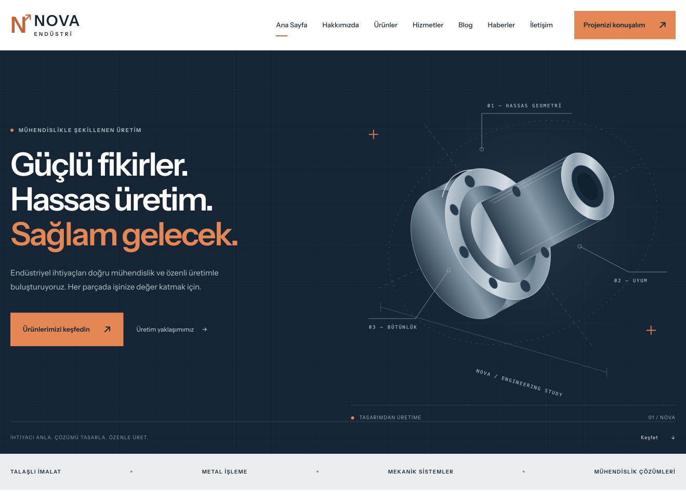

| Ürün kataloğu | Ürün detayı |
| --- | --- |
| 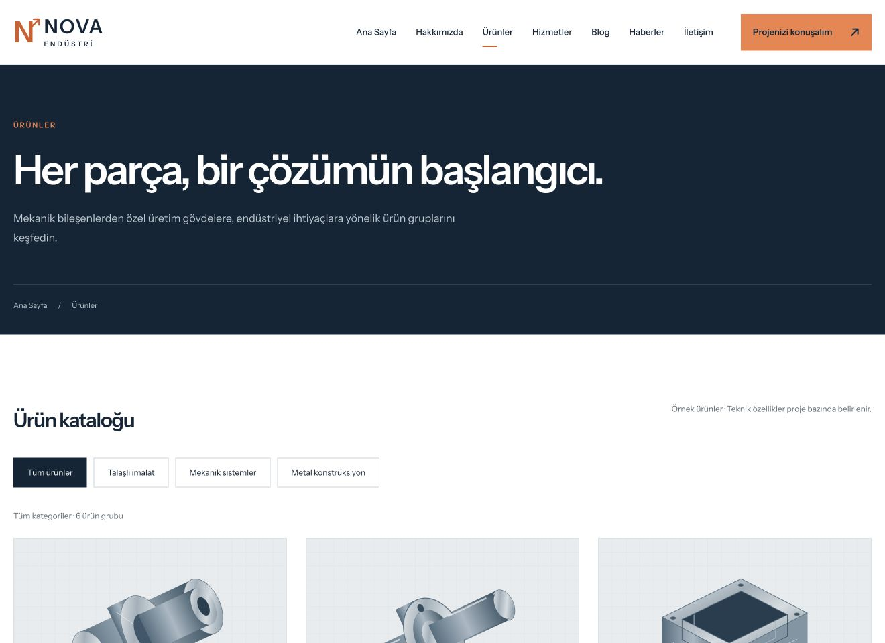 | 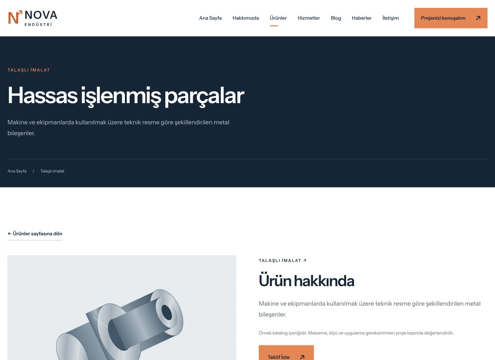 |

| Blog ve içgörüler | Yönetim paneli |
| --- | --- |
| 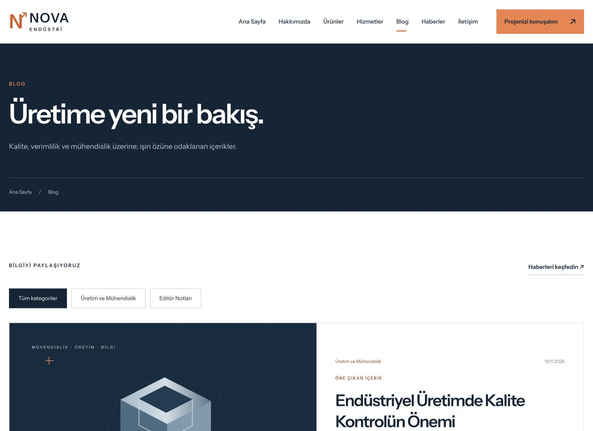 | 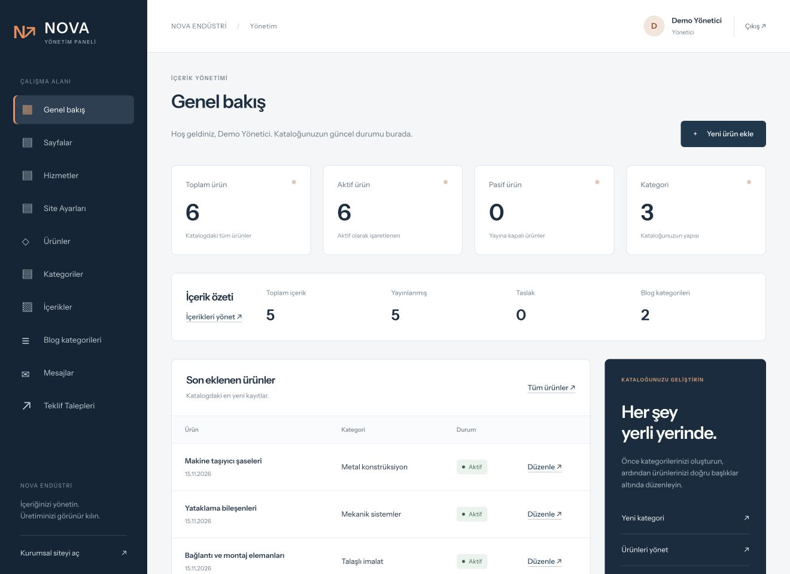 |

| Ürün yönetimi | Teklif yönetimi |
| --- | --- |
| 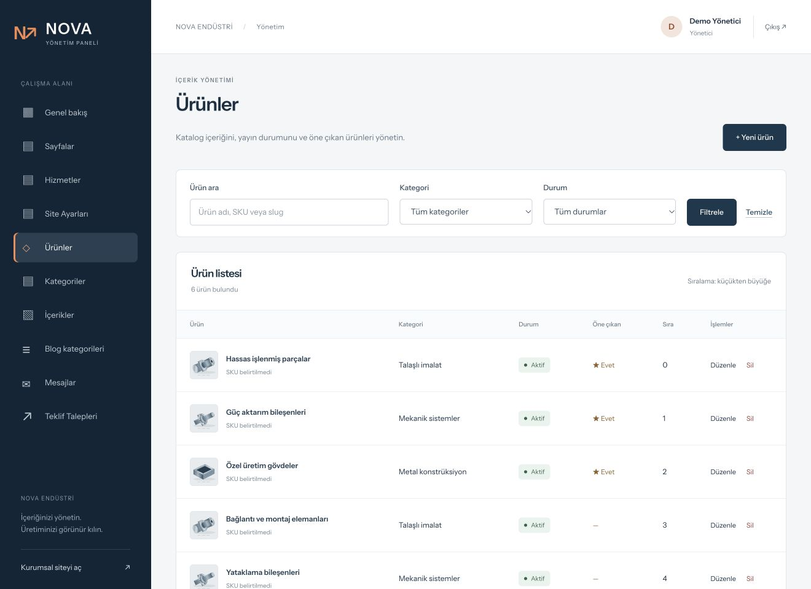 | 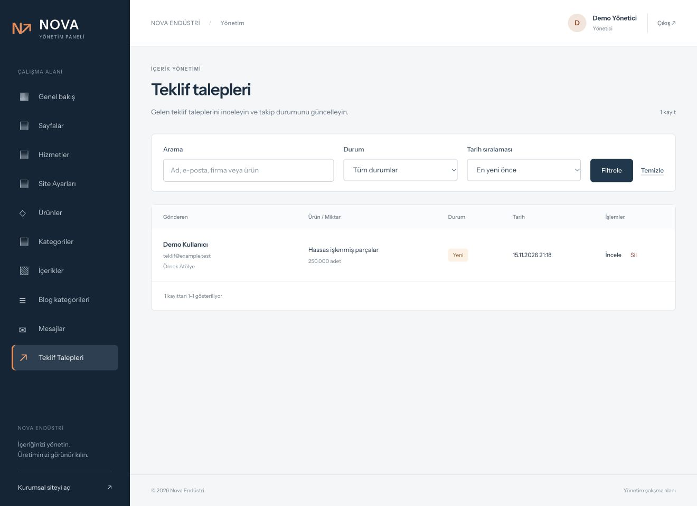 |

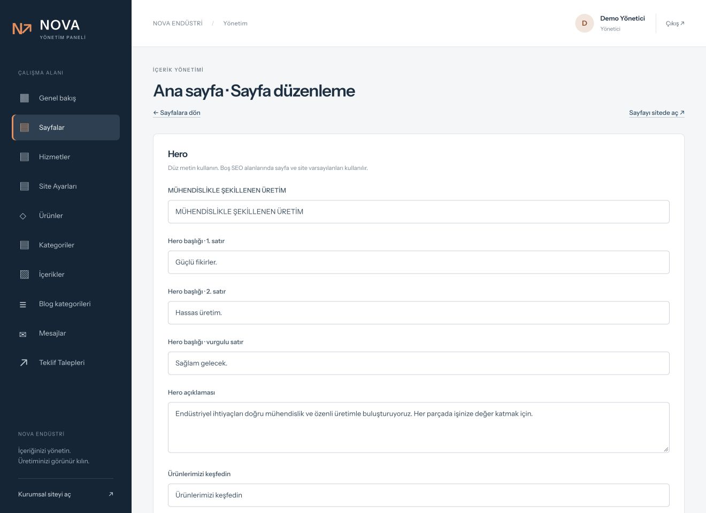

| Telefon menüsü | Telefon kataloğu | Telefon teklif formu |
| --- | --- | --- |
| 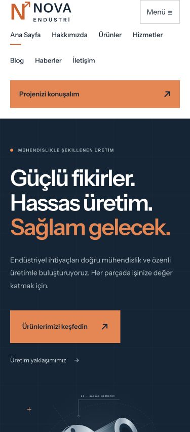 | 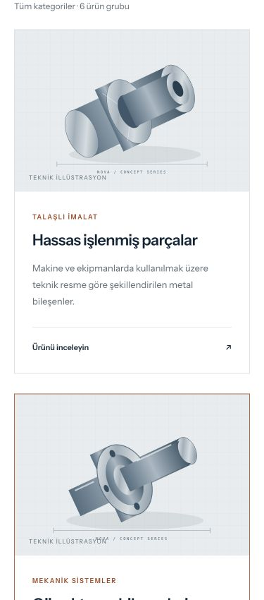 | 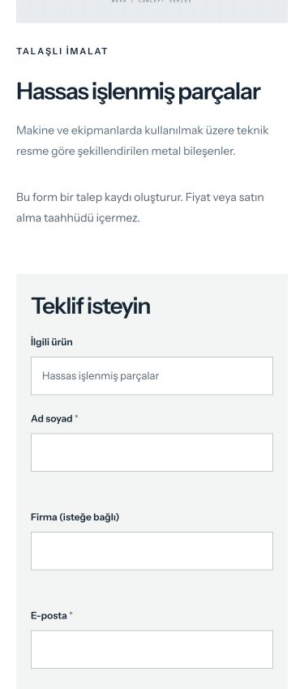 |

[Tablet kataloğu](docs/screenshots/katalog-mobil-768.jpg) · [Telefonda yönetim paneli](docs/screenshots/admin-mobil-375.jpg) · [Tablette yönetim paneli](docs/screenshots/admin-mobil-768.jpg)

### Demo

Portföy sunumu GitHub’daki ekran görüntülerinden ve [yerel kurulum](#yerel-kurulum) adımlarından oluşur. Uygulamayı örnek katalog ve CMS içerikleriyle yerelde çalıştırabilirsiniz.

## Özellikler

| Ziyaretçi arayüzü | Yönetim paneli |
| --- | --- |
| Ana sayfa, Hakkımızda, Hizmetler ve İletişim | Session tabanlı yönetici girişi ve çıkışı |
| Ürün kataloğu, kategori filtresi ve sayfalama | Dashboard ve kayıt sayaçları |
| Ürün detayları ve ürün bazlı teklif formu | Ürün ve kategori CRUD, görsel yönetimi |
| Blog, haberler ve kategori filtreleri | Blog/haber, kategori ve güvenli Markdown önizlemesi |
| İletişim formu ve durum bildirimleri | Mesajlar, teklifler, durumlar ve özel yönetici notları |
| Mobil menü ve responsive yerleşimler | Yapılandırılmış kurumsal sayfa CMS’si |
| Meta, canonical, Open Graph ve sitemap | Hizmet CRUD, sıralama ve aktif/pasif durumu |
| Türkçe hata ve boş durum ekranları | Marka, iletişim, sosyal medya ve SEO ayarları |

## Teknolojiler

- **Backend:** PHP, Laravel 13.42.0, Eloquent ORM, Laravel Session Authentication.
- **Arayüz:** Blade components, Tailwind CSS 4.3.3, Vite 8.3.5 ve sade JavaScript.
- **Veritabanı:** SQLite; migration, factory ve seeder’lar.
- **İçerik:** Mevcut bağımlılık olan League CommonMark üzerinden Markdown.
- **Test ve biçimlendirme:** Pest 5.3.4, PHPUnit ve Laravel Pint.

Kesin bağımlılık sürümleri `composer.lock` ve `package-lock.json` içinde tutulur. React, Vue, Livewire veya ayrı bir SPA/API istemcisi kullanılmaz.

## Mimari ve teknik yaklaşım

- **MVC:** HTTP akışları controller’larda, doğrulama Form Request’lerde, veri ilişkileri Eloquent modellerindedir. Tekrarlanan arayüzler Blade bileşenleriyle paylaşılır.
- **Veritabanı tasarımı:** Ürün–kategori ve içerik–kategori/yazar ilişkileri foreign key ile korunur. Ürün silinse bile teklifin ürün adı snapshot alanında kalır; ilişki null olur.
- **Yetkilendirme:** Yönetim rotaları `auth` ve `admin` middleware ile korunur. Yönetici kontrolü route model binding’den önce çalışır. Kullanıcı rolü toplu atamayla değiştirilemez.
- **Form güvenliği:** CSRF, Form Request doğrulaması, giriş/form hız sınırlaması ve halka açık formlarda honeypot uygulanır. Yönetici notları halka açık sayfalarda gösterilmez.
- **CMS:** Dört sabit kurumsal sayfa, mevcut Blade tasarımına bağlı alanlarla düzenlenir; serbest HTML editörü kullanılmaz. Genel ayarlar tekil kayıt olarak saklanır; SMTP şifreleri ve uygulama anahtarları panele taşınmaz.
- **Dosyalar:** JPG/PNG/WebP, en fazla 4 MB ve 6000 × 6000 piksel kabul edilir. Storage dosya adlarını üretir. Paylaşılan görseller ve repodaki SVG varlıkları silme kontrolüyle korunur.
- **İçerik güvenliği:** Blade çıktıları escape edilir. Markdown’da ham HTML ve güvensiz bağlantılar engellenir; başlıklar H2/H3 ile sınırlandırılır.
- **Mail:** Kayıt önce veritabanına yazılır. Bildirim başarısız olsa da talep korunur. Bildirimde müşteri mesajı yerine korumalı panel bağlantısı bulunur.
- **SEO:** Kurumsal sayfa SEO alanları, ürün/içerik meta alanları ve sitemap vardır. Pasif ürünler, taslak/gelecek tarihli içerikler ve pasif kategorilerdeki kayıtlar sitemap dışında kalır.
- **Performans:** İlişkiler eager loading ile alınır; admin listeleri sayfalanır. Dashboard için ölçülen test senaryosunda sorgu sayısı 13’ten 11’e indirilmiştir. Bu, gerçek kullanıcı gecikmesine ilişkin bir hız iddiası değildir.

## Yerel kurulum

### Gereksinimler

- **PHP 8.4.1 veya üzeri**; bu proje PHP **8.5.0** ile doğrulanmıştır. Kilitli test ve Symfony bağımlılıkları nedeniyle yalnızca Laravel’in temel PHP alt sınırını esas almayın.
- Composer 2 ve Laravel’in gerektirdiği PHP uzantıları; özellikle PDO SQLite/SQLite3, mbstring, XML/DOM, fileinfo ve cURL. Görsel testleri için GD gerekir.
- Node.js **20.x (20.19+)** veya **22.12 ve üzeri** ve npm; Vite’ın sürüm koşuluna uygun bir Node kurulumu kullanın.
- Git ve terminal. Aşağıdaki komutlar macOS/Linux kabukları içindir.

### Uygulamayı hazırlama

Bu adımları yeni clone içinde çalıştırın. Mevcut `.env` veya veritabanının üzerine yazmayın.

```bash
git clone https://github.com/selcanakturk/nova-endustri.git
cd nova-endustri
composer install
cp .env.example .env
php artisan key:generate --no-interaction
php -r "is_file('database/database.sqlite') || touch('database/database.sqlite');"
php artisan migrate --no-interaction
php artisan storage:link --no-interaction
npm ci
npm run build
```

`composer install` ve `npm ci` kilit dosyalarındaki sürümleri kurar. İlk kurulum ve fontların ilk build sırasında indirilmesi internet erişimi gerektirir. `.env.example` SQLite, database session/cache ve yerel log mail sürücüsüyle başlar. SQLite varsayılanı `database/database.sqlite` dosyasıdır. Başka bir dosya kullanacaksanız yalnızca kendi `.env` dosyanızdaki `DB_DATABASE` değerine mutlak yol verin.

### Yönetici hesabı ve demo içerikleri

Önce kendi yönetici hesabınızı **etkileşimli terminalde** oluşturun:

```bash
php artisan admin:create
```

Komut ad, e-posta ve gizli parola girişini ister. Parola en az 12 karakter; büyük/küçük harf, rakam ve sembol içermeli, en fazla 72 bayt olmalıdır. `--name` ve `--email` seçenekleri desteklenir; parola seçeneği yoktur. Komut etkileşimsiz çalışmayı reddeder ve var olan hesabı sıfırlamaz.

Ardından:

```bash
php artisan db:seed --no-interaction
php artisan serve --host=127.0.0.1 --port=8000
```

Yerel ziyaretçi arayüzü: `http://127.0.0.1:8000`; yönetim girişi: `http://127.0.0.1:8000/admin/login`. `.env` içindeki `APP_URL` değerini kullandığınız yerel adresle eşleştirin.

Seeder; 3 ürün kategorisi, 6 ürün, 2 blog kategorisi, 5 blog/haber içeriği, 4 kurumsal sayfa, 3 hizmet ve tek site ayarı kaydı hazırlar. Mesaj/teklif veya paylaşılmış yönetici kimlik bilgisi oluşturmaz. Blog seeder’ı mevcut bir yöneticiye ihtiyaç duyar; hesabı sonradan oluşturduysanız `php artisan db:seed --class=PostSeeder --no-interaction` çalıştırabilirsiniz. Seeder’lar mevcut eşleşen kayıtları güncellemez; mevcut yönetici değişikliklerini korur. Silinen başlangıç kayıtları yeniden oluşturulabilir.

CSS/JS geliştirmesinde ayrı terminalde `npm run dev` çalıştırılabilir. Vite manifest bulunamazsa `npm run build` çalıştırın. Bu proje için `migrate:fresh` veya `db:wipe` gerekli değildir.

## Yönetim adresleri

| Modül | Yol |
| --- | --- |
| Dashboard / giriş | `/admin` / `/admin/login` |
| Ürünler / kategoriler | `/admin/products` / `/admin/categories` |
| İçerikler / blog kategorileri | `/admin/posts` / `/admin/post-categories` |
| Mesajlar / teklifler | `/admin/messages` / `/admin/quotes` |
| Kurumsal sayfalar / hizmetler | `/admin/pages` / `/admin/services` |
| Site ayarları | `/admin/settings` |

## E-posta bildirimleri

`.env` içinde `INQUIRY_NOTIFICATION_EMAIL` boşken bildirim gönderilmez; formlar yine veritabanına kaydedilir. Alıcı tanımlandığında `MAIL_MAILER=log` gerçek gönderim yerine yerel log kullanır. Dışarıya e-posta göndermek için SMTP sağlayıcınıza ait `MAIL_MAILER`, `MAIL_HOST`, `MAIL_PORT`, `MAIL_SCHEME`, `MAIL_USERNAME`, `MAIL_PASSWORD` ve onaylı `MAIL_FROM_ADDRESS` değerlerini kendi ortamınızda ayarlayın.

Kimlik bilgilerini Git’e veya Site Ayarları paneline yazmayın. Bildirimler senkron çalışır; bu akış için queue worker gerekmez. SMTP hatası kaydedilmiş talebi silmez. Gerçek SMTP teslimi ayrıca doğrulanmalıdır.

## Testler ve kalite kontrolleri

```bash
php artisan test --compact
php artisan test --compact tests/Feature/QualityAssuranceTest.php
composer audit --locked
vendor/bin/pint --dirty --format agent
npm run build
php artisan view:cache --no-interaction
php artisan view:clear --no-interaction
php artisan route:list --except-vendor --no-interaction
php artisan migrate:status --no-interaction
```

15 Kasım 2026 doğrulamasında **430 test ve 1.944 doğrulama**, üretim derlemesi ve Blade derlemesi başarılıydı. Önceki temiz kurulum kontrolünde Composer audit ve Pint de geçti. Uygulamada 70 uygulama rotası ve uygulanmış 14 migration bulunur. Testler `phpunit.xml` üzerinden `sqlite :memory:` kullanır. Testleri önbelleğe alınmış üretim yapılandırması bulunan bir dizinde çalıştırmayın. Ayrı bir test kopyası kullanın veya çalıştırmadan önce o kopyada `php artisan config:clear --no-interaction` çalıştırın.

Testler; yetkilendirme, CRUD, görünürlük, kategori filtreleri, sayfalama, CMS, seeder idempotence, dosya sınırları/paylaşılan görseller, Markdown/XSS, CSRF, hız sınırlama, durum geçişleri, mail hataları, SEO ve hata ekranlarını kapsar. Otomatik test başarısı, tüm tarayıcılarda görsel doğrulama veya mutlak güvenlik garantisi anlamına gelmez.

## Temiz kurulum doğrulaması

Faz 7 sırasında, geliştirme `.env` dosyası ve veritabanı kopyalanmadan ayrı bir geçici dizinde Composer install, npm ci, yeni APP_KEY, boş SQLite üzerinde 14 normal migration, etkileşimli `admin:create`, storage bağlantısı, seeder, production build ve testler çalıştırıldı. **430 test ve 1.944 assertion** bu ortamda da geçti. Seeder ikinci kez çalıştırıldığında başlangıç kayıt sayıları değişmedi. PHP platform koşulları ve yerel HTTP sunucusunda ziyaretçi sayfaları/giriş ekranı kontrol edildi.

Bu doğrulama mevcut macOS ortamında PHP 8.5.0 ve Node.js 23.9.0 ile yapıldı; başka işletim sisteminde veya minimum sürümlerde ayrıca çalıştırılmış bir test değildir.

## Demo notları

[Demo notları](docs/DEMO.md) yerel prova sonuçlarını, görsel kontrol kapsamını ve olası bir dağıtım için teknik gereksinimleri içerir.

## Lisans

Projeye ait bir `LICENSE` dosyası bulunmuyor; lisans tercihi henüz belirlenmedi. Başlangıç şablonundan kalan MIT beyanı `composer.json` dosyasından kaldırıldı; bu teslim projeye yeni bir lisans atamaz. Laravel ve diğer bağımlılıkların kendi lisansları geçerlidir.
